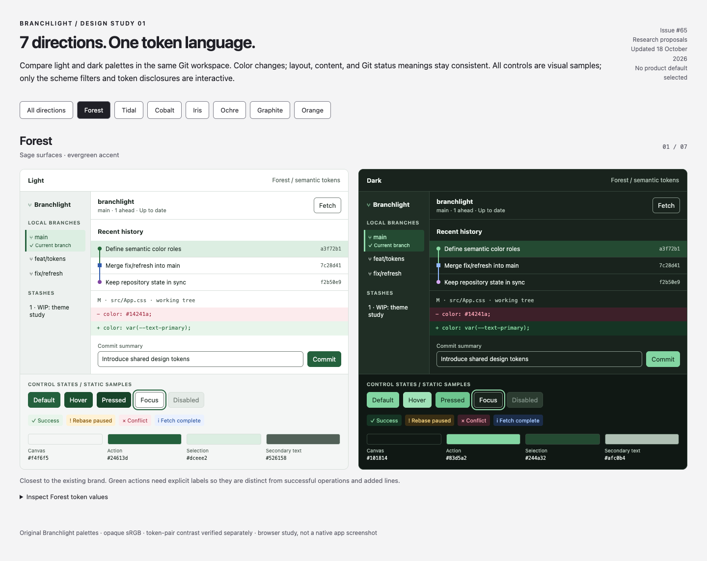
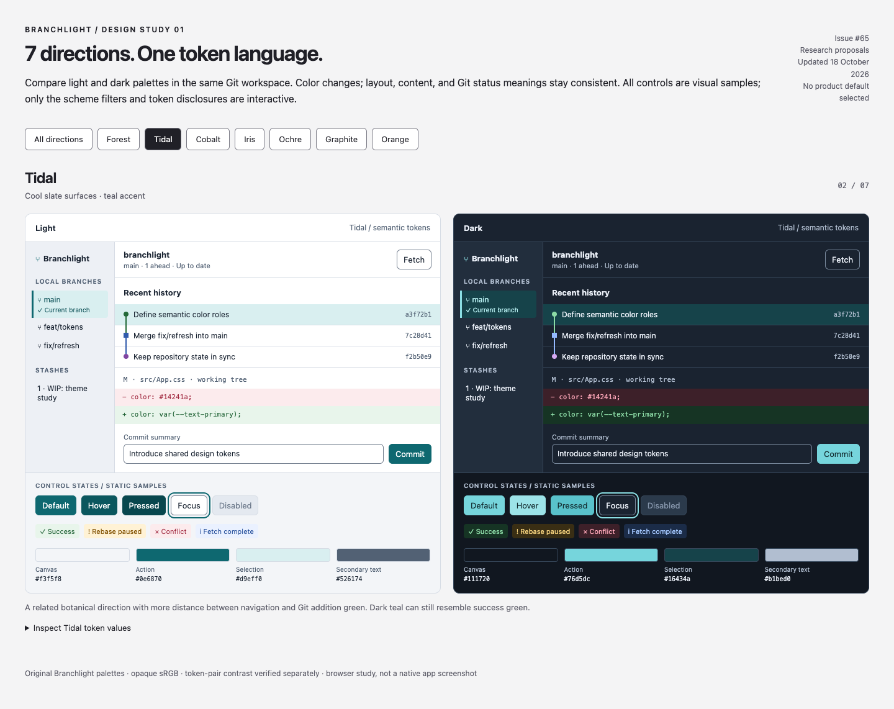
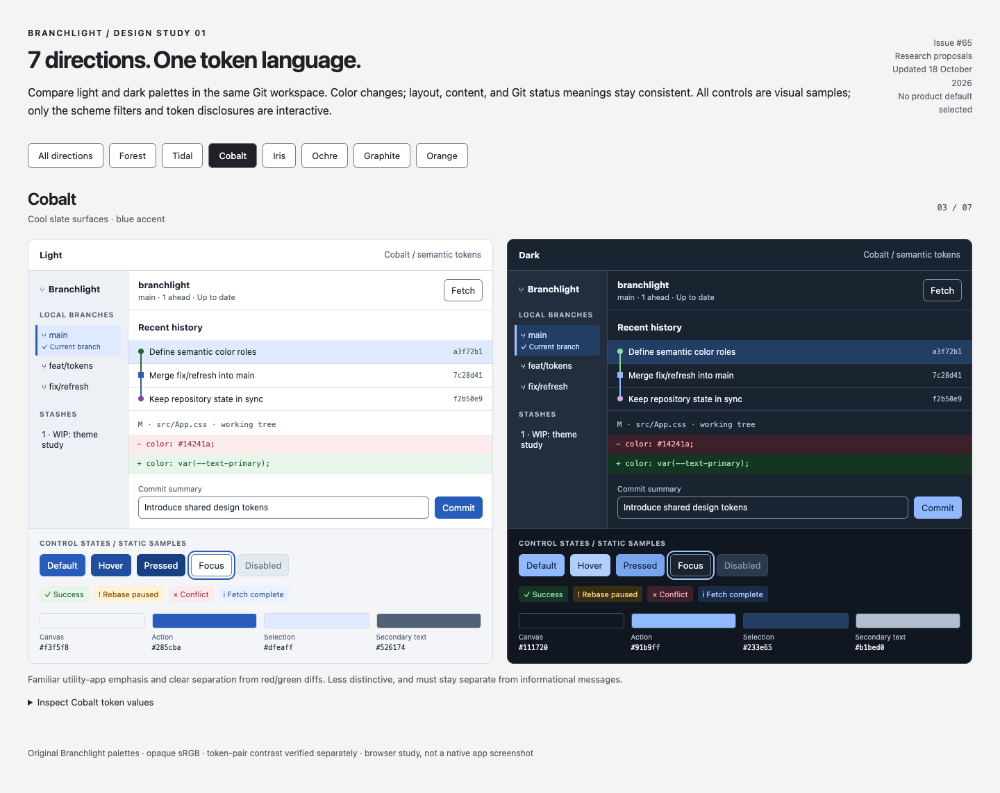
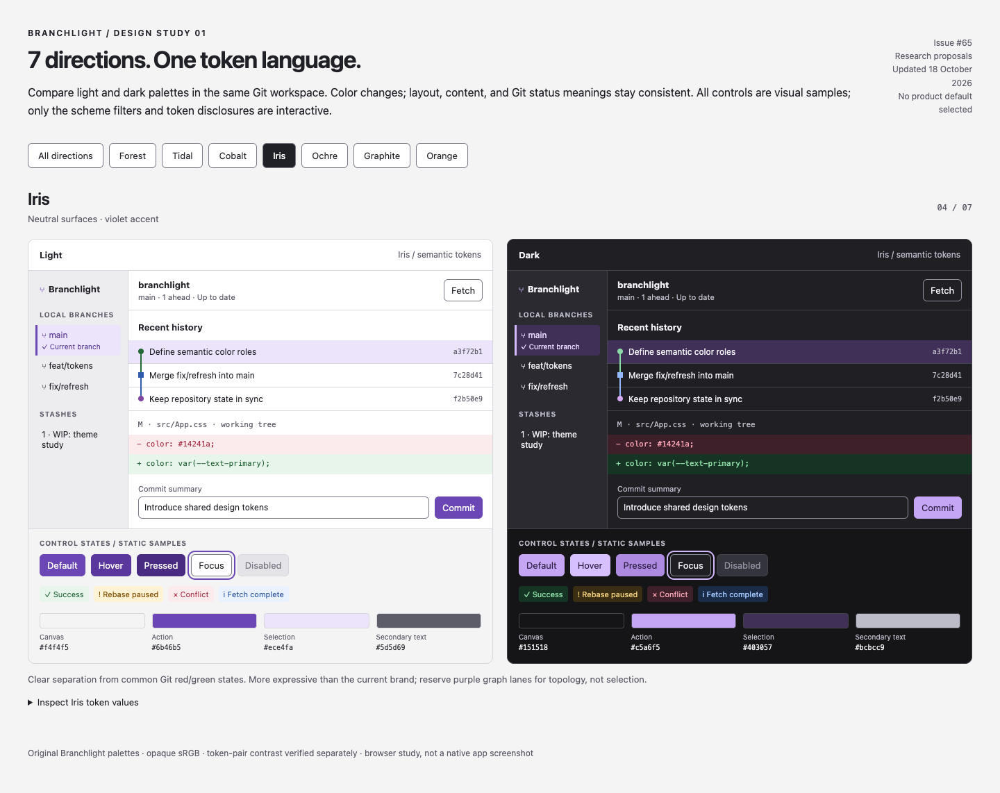
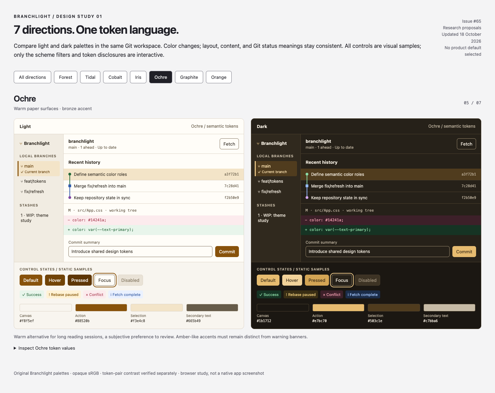
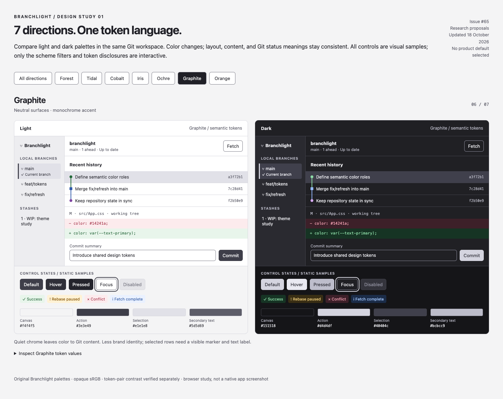
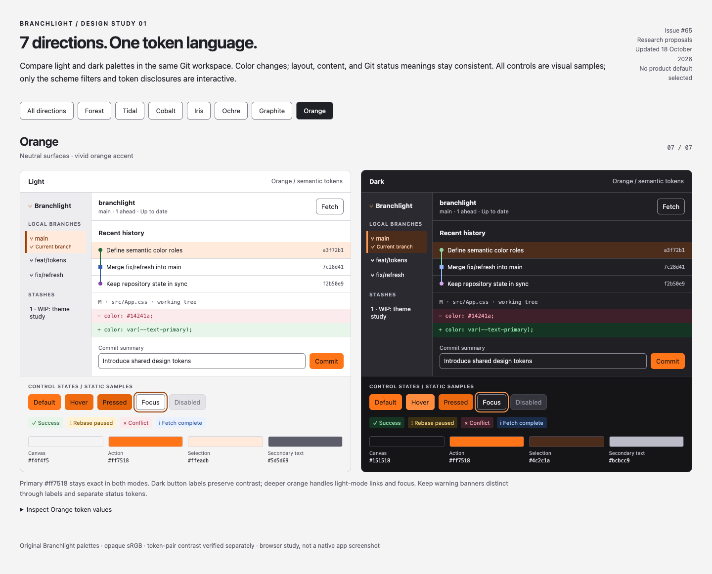

# Branchlight design system: theme research

Research for [#65](https://github.com/wctiger/branchlight/issues/65), prepared
2026-10-12, updated 2026-10-18. This PR proposes visual foundations and seven color directions for
review. It does not choose a product default or implement theme preferences.
The existing app remains unchanged; #65 stays open for implementation.

## Review the options

Open [gallery.html](gallery.html) locally in a browser. It is self-contained,
works from a `file://` URL, and needs no server, installation, external fonts,
network access, or Git repository access. GitHub displays its source rather than
running it, so the screenshots below are also included for PR review.

Use the scheme buttons to compare one direction at a time, or **All directions**
to inspect all seven. Each direction shows the same light/dark workspace, branches,
history, red/green diff, selection, control states, and operation status samples.
Expand its token table to inspect all values. The workspace controls are visual
samples, not working Git operations. `?scheme=cobalt` opens a particular proposal.

| Direction | Light / dark primary action | Character | Main tradeoff |
|---|---|---|---|
| **Forest** | `#24613d` / `#83d5a2` | Sage and evergreen; evolves the current green identity | Actions can resemble success/addition green |
| **Tidal** | `#0e6870` / `#76d5dc` | Teal on cool slate; a less literal botanical identity | Teal can still resemble success green |
| **Cobalt** | `#285cba` / `#91b9ff` | Familiar blue utility app; separates actions from diffs | Less distinctive; blue also denotes information |
| **Iris** | `#6b46b5` / `#c5a6f5` | Violet on neutral gray; distinct from Git red/green | A larger change to the brand; purple graph lanes need separate semantics |
| **Ochre** | `#88520b` / `#e7bc70` | Bronze on warm paper/charcoal | Accent can resemble warnings; reading comfort is subjective |
| **Graphite** | `#3e3e49` / `#d4d4df` | Monochrome chrome; Git content supplies the color | Less brand identity; selection needs a marker and label |
| **Orange** | `#ff7518` / `#ff7518` | Vivid orange on neutral surfaces; requested primary stays exact | Needs dark button labels, darker light-mode text/focus, and distinct warning cues |

**Recommendation for discussion:** start with Forest if preserving Branchlight's
current green identity is the priority. Keep Cobalt as the strongest alternative
if distinguishing interface actions from green Git additions matters more.
These are design judgments, not user-research findings. Iris provides a useful
third comparison with an accent outside the usual Git red/green/blue vocabulary.
Do not ship all seven as a theme picker merely because they are explored here.

### Forest



### Tidal



### Cobalt



### Iris



### Ochre



### Graphite



### Orange



The requested `#ff7518` is the primary action fill in both modes. It pairs with
dark `#24150c` button labels. Light-mode accent text and focus use deeper
`#9b3d00`; the bright primary itself is not used for small text on a light
surface. Hover/pressed fills stay orange. Warning and Git colors keep their
existing independent meanings.

## Research and decisions it informs

| Primary source | Finding | Branchlight proposal |
|---|---|---|
| [Radix Colors: scale use cases](https://www.radix-ui.com/colors/docs/palette-composition/understanding-the-scale) | Separates backgrounds, interaction states, borders, solid fills, and text into intended uses | Define explicit roles for each state rather than changing opacity or reversing a light scale |
| [Material 3: color roles](https://m3.material.io/styles/color/roles) | Pairs a container with its intended foreground | Keep `action.primary` with `action.onPrimary`, and status/diff backgrounds with their own text roles |
| [Carbon: color](https://www.carbondesignsystem.com/building-blocks/foundations/color/overview) | Stable token meanings span themes; dark layers become lighter as they rise | Use canvas → subtle → panel layers deliberately; avoid translucent panels that make pair checks ambiguous |
| [Atlassian: design tokens](https://atlassian.design/foundations/tokens/design-tokens/) | Tokens capture purpose across color, spacing, typography, and elevation | Keep one semantic API, with brand scheme and light/dark mode as independent choices |
| [DTCG Format Module 2025.10](https://www.designtokens.org/tr/2025.10/format/) | Defines a JSON interchange format for tokens and references | Consider DTCG export when design tooling needs it; this research JSON is a deliberately simple local format, not a DTCG-conformance claim |
| [WCAG text contrast](https://www.w3.org/WAI/WCAG22/Understanding/contrast-minimum.html), [non-text contrast](https://www.w3.org/WAI/WCAG22/Understanding/non-text-contrast.html), [use of color](https://www.w3.org/WAI/WCAG22/Understanding/use-of-color.html) | Normal text needs 4.5:1; required non-text indicators need 3:1; meaning needs cues besides hue | Measure actual foreground/background pairs; retain labels, diff +/− markers, selected-row markers, and topology |

These are original Branchlight palettes informed by the sources' approaches;
they are not copied Radix, Material, Carbon, or Atlassian palettes. No UI library
or runtime dependency is introduced. Radix's APCA targets are not treated as
evidence that a particular WCAG 2.x ratio passes: this study measures WCAG ratios
directly. Source facts and the judgments above are intentionally distinguishable.

## Proposed token contract

Use three layers during implementation:

1. **Palette primitives:** named hue/neutral values, internal to the token source.
2. **Semantic roles:** stable meanings consumed by UI, independent of palette.
3. **Component aliases:** add only where a component must evolve independently,
   such as `button.primary.background → action.primary`.

The research stores resolved semantic colors in [themes.json](themes.json),
making all fourteen proposals easy to inspect. It does not prematurely create a
full primitive scale or component library. The same set of 34 color roles is
present in each palette; the generator verifies parity.

| Group | Roles and use |
|---|---|
| Surfaces | `surface.canvas`, `.panel`, `.subtle`, `.hover`; app base, content, supporting areas, interaction |
| Borders | `border.subtle` for decorative separation; `.control` for required control boundaries |
| Text | `text.primary`, `.secondary`, `.accent`, `.disabled`; never use secondary color as a background |
| Primary action | `action.primary`, `.primary.hover`, `.primary.active`, `.onPrimary`; paired fill and label |
| Disabled | `action.disabled` with `text.disabled`; real disabled semantics rather than only opacity |
| Selection | `selection.background`, `.text`; add a marker and explicit current-branch label |
| Focus | `focus.ring`; 2px outline with 3px offset, checked against adjacent surfaces |
| Git diffs | `git.add.background`/`.text`, `git.delete.background`/`.text`; always retain +/− markers |
| Status | `status.success`, `.warning`, `.error`, `.info`, each with `.background`/`.text` |
| Graph | `graph.lane.1`…`.4`; topology categories, independent of brand/action colors |

CSS names follow `--` plus dots replaced with hyphens. For example,
`surface.panel → --surface-panel`. Foregrounds must only be used on their
documented backgrounds. Graph colors are shared by all directions within a mode;
changing a brand accent must not reassign topology or make success red.
Lane contrast is measured against surfaces, not between lanes. Real graph work
still needs branch/ref labels and topology; hue alone cannot identify a branch.

Non-color foundations stay constant to make comparisons fair: a local system UI
font, a local monospace font for hashes/diffs, 12px labels and 13px dense UI body
text, a 4px spacing unit, 6px control radius, 10px panel radius, 32px controls,
and 120ms optional feedback respecting reduced motion. These are proposals for
desktop density, with zoom, touch target size, and Windows typography to review
during implementation. No extra font download or new icon package is required.

## Implementation sequence after selecting a direction

1. Introduce the chosen light/dark semantic CSS variables and shared typography,
   spacing, and control primitives without changing Git behavior.
2. Migrate landing, workspace chrome, branches/stashes/history, then inspection
   and diff presentation (coordinate with #37). Preserve existing data and
   mutation flows; this study's layout is illustrative rather than a redesign
   requirement.
3. Coordinate with [#58](https://github.com/wctiger/branchlight/issues/58) for
   Light / Dark / System selection, local persistence, system-change handling,
   startup initialization before paint, and correct `color-scheme` on native
   controls. These preferences are separate from the research scheme filter.
4. Add component specimens for empty/loading/error/conflict and recovery dialogs,
   verify keyboard navigation, zoom and contrast in the rendered app on macOS
   and Windows, then update `docs/V1_VERIFICATION.md` with actual capability
   evidence. Native folder pickers remain governed by the OS.

## Reproduce and validate

```sh
bun docs/design-system/build.mjs
bun docs/design-system/build.mjs --check
open docs/design-system/gallery.html
```

Edit `themes.json` or `gallery.template.html`, then regenerate; do not hand-edit
`gallery.html`, `CONTRAST.md`, or `contrast.csv`. The gallery embeds the JSON for
offline review. The generator fails on mismatched token sets, invalid sRGB
colors, undefined CSS variables, or a failed declared contrast pair. `--check`
also fails when generated artifacts are stale.

[Contrast evidence](CONTRAST.md) records all 854 passing pairs across fourteen
palettes; [contrast.csv](contrast.csv) includes each ratio and target. This is
pair evidence for the proposal, not a full accessibility audit or native runtime
verification. Decorative dividers and disabled controls are excluded. Actual
screenshots are browser captures of the gallery, not a running Tauri app.

Browser verification and repository checks for this PR are recorded in its
description. Shipping behavior has not changed, so the V1 capability matrix does
not gain a theme-support claim from this research.
